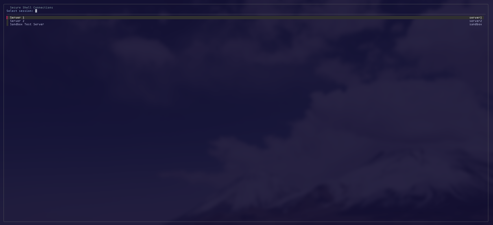
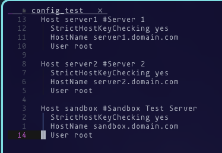

## XXH (SSH Quick Session Access for TMUX)

XXH scrubs your `$HOME/.ssh` directory for any config files (filename must begin with `config`) and adds hosts found there to the list of connectable hosts. It then presents a list of hosts and descriptions via fzf.

### Modes

| Invocation | Behavior |
|---|---|
| `xxh` | Select one or more hosts with Enter — each opens in a new tmux window |
| `xxh -s` | Select one or more hosts with Enter — opens in splits across new tmux windows, up to 4 panes per window |
| Semicolon in fzf | Select one or more hosts — opens each as a new split in the current tmux window |

### Flags

| Flag | Description |
|---|---|
| `-s` | Split-window mode (see above) |
| `-k <key>` | Override the split key (default: `;`) |

## SSH Host Definitions

In your SSH config files, add a `#` on the `Host` line — anything after the `#` is used as the display name in fzf. Hosts without a `#` will fall back to displaying the hostname.

### Credits
Some code (specifically the list) and major inspiration drawn from 'sshto' - https://github.com/vaniacer/sshto
